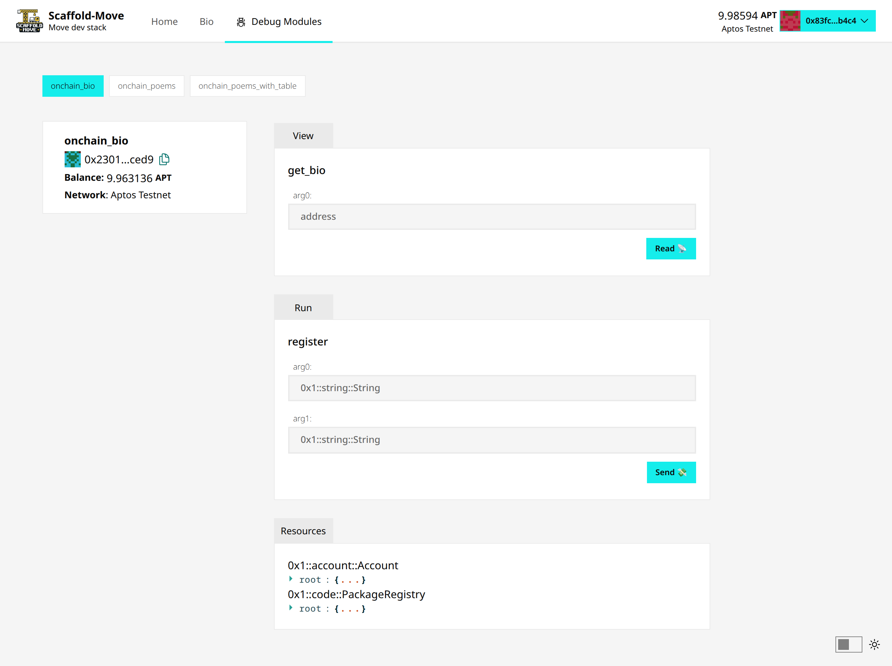

# 🏗️ Scaffold Move

<div align="center">


<h4 align="center">
  <a href="https://scaffold-move-docs.vercel.app/">Documentation</a> |
  <a href="https://scaffold-move-chi.vercel.app/">Website</a>
</h4>
</div>

🧪 Scaffold Move is an open-source, cutting-edge toolkit for building decentralized applications (dApps) on Aptos or any other Move-based blockchain. It's designed to streamline the process of creating and deploying Move modules and building user interfaces that interact seamlessly with those modules.

⚙️ Built using Move, Aptos TS SDK, Next.js, Tailwind CSS, and TypeScript.

- 🛫 **Deployment Scripts**: Simplify and automate your deployment workflow.
- ✅ **Module Hot Reload**: Your frontend automatically adapts to changes in your Move modules as you edit them.
- 🪝 **Custom Hooks**: A collection of React hooks to simplify interactions with Move modules.
- 🧱 **Components**: A library of common Web3 components to rapidly build your frontend.
- 🔐 **Wallet Integration**: Connect to any Aptos-compatible wallet and interact with the Aptos network directly from your frontend.

Perfect for hackathons, prototyping, or launching your next Move project!



## Requirements

Before you begin, you need to install the following tools:

- [Node (>= v20)](https://nodejs.org/en/download/)
- Yarn ([v1](https://classic.yarnpkg.com/en/docs/install/) or [v2+](https://yarnpkg.com/getting-started/install))
- [Git](https://git-scm.com/downloads)
- The CLI for the network(s) you deploy to:
  - Movement: [Movement CLI](https://docs.movementnetwork.xyz/devs/movementcli) 7.4.x. Movement only accepts Move bytecode v7, which newer Aptos CLIs can't produce.
  - Aptos: [Aptos CLI](https://aptos.dev/build/cli) 9.6 or newer (`aptos update aptos`). The Aptos framework needs a recent CLI to compile.

## Quickstart

To get started with Scaffold Move, follow the steps below:

1. Clone this repo & install dependencies

```
git clone https://github.com/arjanjohan/scaffold-move.git
cd scaffold-move
yarn install
```

2. Then, create an account:

```
yarn account
```

This command creates an account for the default network (`defaultNetwork` in `packages/move/move.config.ts`) and funds it from the faucet when the network has a faucet API. Use `--network` for another network, e.g. `yarn account --network aptos_testnet`. Valid networks are the keys of `defaultChains` in `packages/common/chains.ts`, or `custom` together with `--rest-url` (and optionally `--faucet-url`).

Every network gets its own account, stored as a CLI profile named after the network in `packages/move/.movement/config.yaml` (Movement) or `packages/move/.aptos/config.yaml` (Aptos). Running `yarn account` again for a network keeps its existing account. Add `--new` to create a new one; the previous account is kept as a profile named `<network>_old_<timestamp>`.

All network information (chain IDs, RPC, indexer, faucet and explorer URLs) lives in `packages/common/chains.ts` and is shared by the move scripts and the frontend.

3. Deploy the test modules:

```
yarn deploy
```

This command deploys the move modules in `packages/move/sources` to the default network, or to `--network <network>`. The modules can be modified to suit your needs. `packages/move/scripts/deploy.ts` publishes them with the network's CLI, deploying the addresses set to `'_'` in `Move.toml` to the network's account. After this it runs `packages/move/scripts/load-modules.ts` to make the new modules available in the nextjs frontend.

`Move.toml` depends on Movement's framework. For Aptos networks the scripts compile against the Aptos framework with `--override-std`. `yarn compile` and `yarn test` also take `--network`.

4. On a second terminal, start your NextJS app:

```
yarn start
```

Visit your app on: `http://localhost:3000`. You can interact with your Move modules using the `Debug Modules` page. You can tweak the app config in `packages/nextjs/scaffold.config.ts`. The app starts on the first network in its `targetNetworks` (Movement testnet, the same as `yarn deploy`) and follows the network of the connected wallet.

**What's next**:

- Edit your Move module `OnchainBio.move` in `packages/move/sources`
- Edit your frontend homepage at `packages/nextjs/app/page.tsx`. For guidance on [routing](https://nextjs.org/docs/app/building-your-application/routing/defining-routes) and configuring [pages/layouts](https://nextjs.org/docs/app/building-your-application/routing/pages-and-layouts) checkout the Next.js documentation.
- Edit the Move unit tests in `packages/move/tests` and run them with `yarn test`.

## Local network

To develop against your own node instead of a testnet:

1. Start a local node with a faucet. It needs ports 8080 (node API) and 8081 (faucet) to be free.

```
yarn chain
```

Every `yarn chain` starts a new, empty chain, so run step 2 again after each start.

2. In a second terminal, create (or refund) your account and deploy:

```
yarn account --network local
yarn deploy --network local
```

3. Add the local network to the app: uncomment `defaultChains.local` in `targetNetworks` in `packages/nextjs/scaffold.config.ts`.
4. Connect a wallet that supports a local or custom network at `http://127.0.0.1:8080/v1`.
5. Fund your wallet account with "Faucet" in the wallet dropdown, or with `yarn faucet <address> --network local`.

`yarn faucet <address>` also works on Movement testnet. Aptos testnet's faucet is web-only: https://aptos.dev/network/faucet

## AI coding agents

Scaffold Move ships with setup for coding agents (Claude Code, Cursor, Codex, OpenCode and others):

- `AGENTS.md` describes the repo's conventions and gotchas: one CLI per network, upgrade rules, generated files and the frontend hooks. `CLAUDE.md` points to it.
- The [Context7](https://context7.com) MCP server gives agents current library docs (`.mcp.json`, `.cursor/mcp.json`, `opencode.json`).
- Skills in `.agents/skills`, linked from `.claude/skills` and `.cursor/skills`, all checked on both Movement and Aptos:
  - `add-module`: a new module end to end, from Move code and tests to deployment and a page.
  - `move-security`: common security pitfalls in Move modules.
  - `fungible-asset` and `digital-asset`: tokens and NFTs, each starting from a tested example module.
  - `indexer`: lists and history through the GraphQL indexer, and how the two networks' indexers differ.
- `scaffold-move-reviewer`, a code-review agent in `.agents/agents`, linked from `.claude/agents` and `.cursor/agents`.

## Future Development

Scaffold Move has successfully implemented core features essential for Move developers, providing a robust foundation for building decentralized applications. The current version offers a streamlined development experience with hot module reloading, custom hooks, and seamless wallet integration.

Looking ahead, we have an exciting roadmap of enhancements and new features planned:

- Add a testing framework for Move modules.
- Enhance documentation and create tutorials for easier onboarding.
- Develop additional pre-built components for common dApp functionalities.
- Integrate different templates/configurations (similar to [create-aptos-dapp](https://aptos.dev/en/build/create-aptos-dapp))

We're committed to evolving Scaffold Move based on community feedback and emerging best practices in the Move ecosystem. For a detailed list of upcoming features and to contribute ideas, please check our [GitHub Issues](https://github.com/arjanjohan/scaffold-move/issues).

Your input is valuable! If you have suggestions or want to contribute, we encourage you to get involved and help shape the future of Scaffold Move. Join our [developer Telegram channel](https://t.me/+lOn2MJawQlc1YjA8) to connect with the community and stay updated on the latest developments.

## Links

- [Documentation](https://scaffold-move-docs.vercel.app/)
- [Example deployment](https://scaffold-move-chi.vercel.app/)
- [Telegram Community](https://t.me/+lOn2MJawQlc1YjA8)
- [Github](https://github.com/arjanjohan/scaffold-move)

## Credits

None of this would have been possible without the great work done in:
- [Scaffold-ETH 2](https://github.com/scaffold-eth/scaffold-eth-2)
- [Aptos Explorer](https://github.com/aptos-labs/explorer)
- [Aptos Wallet Adapter](https://github.com/aptos-labs/aptos-wallet-adapter)

## Built by

- [arjanjohan](https://x.com/arjanjohan/)
